# Orders API — Serverless REST API con AWS Lambda y API Gateway

API REST pequeña para gestionar órdenes, construida con Java 17, Maven, AWS Lambda y Amazon API Gateway.

## Cómo compilar y probar

Requisitos: Java 17 y Maven 3.9+.

```bash
mvn test       # ejecuta las pruebas unitarias (no requiere AWS)
mvn package    # genera target/orders-api-1.0.0.jar
```

---

## 1. Diseño del API (contrato)

### Representación de una orden

```json
{
  "id": "ORD-001",
  "customerId": "CUST-42",
  "product": "MacBook Air",
  "quantity": 1
}
```

### Formato de error (igual para todos los errores)

```json
{
  "error": "ORDER_NOT_FOUND",
  "message": "Order ORD-999 does not exist"
}
```

| Código `error`     | HTTP | Cuándo                                                       |
|--------------------|------|--------------------------------------------------------------|
| `INVALID_REQUEST`  | 400  | Cuerpo inválido, campo faltante, `quantity < 1`, parámetro faltante |
| `ORDER_NOT_FOUND`  | 404  | La orden solicitada no existe                                |
| `INTERNAL_ERROR`   | 500  | Error inesperado (no se exponen detalles internos)           |

### Operaciones

#### Crear una orden — `POST /orders`

- **Path params:** ninguno · **Query params:** ninguno
- **Request body:**
  ```json
  { "customerId": "CUST-42", "product": "MacBook Air", "quantity": 1 }
  ```
- **Éxito:** `201 Created`, header `Location: /orders/ORD-004`, cuerpo = la orden creada (con el `id` generado).
- **Errores:** `400 INVALID_REQUEST` (JSON inválido, `customerId`/`product` vacíos, `quantity` faltante o < 1), `500 INTERNAL_ERROR`.

#### Consultar una orden — `GET /orders/{id}`

- **Path params:** `id` (ej. `ORD-001`) · **Query params:** ninguno · **Body:** ninguno
- **Éxito:** `200 OK`, cuerpo = la orden.
- **Errores:** `404 ORDER_NOT_FOUND`, `500 INTERNAL_ERROR`.

#### Buscar órdenes de un cliente — `GET /orders?customerId={customerId}`

- **Path params:** ninguno · **Query params:** `customerId` (obligatorio) · **Body:** ninguno
- **Éxito:** `200 OK`, cuerpo = arreglo JSON de órdenes. Si el cliente no tiene órdenes → `200 OK` con `[]`.
- **Errores:** `400 INVALID_REQUEST` (falta `customerId`), `500 INTERNAL_ERROR`.

> `DELETE /orders/{id}` se agrega en el reto final (sección 17).

### Preguntas de diseño

**¿Cuáles son los recursos del API?**
El recurso principal es la **colección de órdenes** (`/orders`) y cada **orden individual** (`/orders/{id}`). El cliente aparece solo como criterio de filtro, no como recurso propio en esta versión.

**¿Por qué `/orders/{id}` para obtener una orden?**
Porque el `id` identifica de forma única a un recurso: la orden es un elemento de la colección `/orders`, y su URL debe ser estable y única. Un identificador de recurso va en el path, no en un parámetro opcional.

**¿Por qué `customerId` es un query parameter en la búsqueda?**
Porque no identifica un recurso: **filtra** la colección `/orders`. El resultado sigue siendo una colección de órdenes (puede estar vacía). Los query params son el mecanismo natural para filtros opcionales y combinables (ej. `?customerId=...&product=...` en el futuro). La alternativa `/customers/{id}/orders` sería válida si los clientes fueran un recurso del sistema, pero no lo son.

**¿Qué debe retornar `POST /orders` al crear una orden?**
`201 Created`, el cuerpo con la orden creada (incluyendo el `id` asignado por el servidor) y un header `Location` con la URL del nuevo recurso (`/orders/ORD-004`).

**¿Qué debe retornar el API si una orden no existe?**
`404 Not Found` con el cuerpo de error `{"error": "ORDER_NOT_FOUND", "message": "Order ORD-999 does not exist"}`. En cambio, buscar un cliente sin órdenes **no** es 404: la colección filtrada existe y está vacía (`200 []`).

**¿Qué información debe contener una respuesta de error?**
Un código estable y legible por máquinas (`error`), útil para que el cliente tome decisiones, y un mensaje legible por humanos (`message`). No debe incluir stack traces ni detalles internos. El estado HTTP comunica la categoría del error; el código `error` la causa específica.

---

## 2. Parte I — Aplicación en Java puro

### Estructura

```
src/main/java/edu/eci/orders/
├── domain/                 # Conceptos del negocio (Java puro)
│   ├── Order.java
│   ├── CreateOrderRequest.java
│   ├── OrderNotFoundException.java
│   └── ValidationException.java
├── application/            # Lógica de la aplicación (Java puro)
│   ├── OrderService.java       # createOrder, getOrder, getOrdersByCustomer
│   └── OrderRepository.java    # interfaz de almacenamiento
└── infrastructure/
    └── InMemoryOrderRepository.java   # almacenamiento en memoria (no persistente)
```

- `OrderService` valida la entrada y lanza **excepciones de dominio** (`ValidationException`, `OrderNotFoundException`). No sabe nada de códigos HTTP: traducir esas excepciones a 400/404 es responsabilidad de la capa HTTP (API Gateway o el adaptador).
- `InMemoryOrderRepository.withSampleData()` precarga `ORD-001`, `ORD-002` (CUST-42) y `ORD-003` (CUST-7), para que las lecturas funcionen en una Lambda recién iniciada. **Los datos en memoria no son persistentes**: se pierden cuando Lambda recicla el entorno de ejecución, y cada función Lambda tiene su propia copia.

### Checkpoint 1

Respuestas al terminar la Parte I (antes de agregar los handlers de Lambda).

**¿Se puede probar la funcionalidad sin AWS?** Sí. `mvn test` ejecuta 21 pruebas JUnit sobre `OrderService` sin ninguna dependencia de AWS ni red.

**¿La aplicación requiere un servidor web?** No. Es una librería de clases Java; se invoca con llamadas a métodos.

**¿Requiere Spring Boot?** No. La única dependencia es JUnit, y solo en scope `test`.

**¿Qué contiene el JAR generado?** Solo las clases compiladas del proyecto (`domain`, `application`, `infrastructure`) y metadatos de Maven (`META-INF/MANIFEST.MF`, `pom.xml`, `pom.properties`). No incluye dependencias ni handlers de Lambda (todavía).

**¿Qué partes de la aplicación conocen HTTP actualmente?** Ninguna. No hay requests, responses, headers ni códigos de estado en el código.

---

## 3. Parte II — Funciones Java en AWS Lambda

No rediseñé la aplicación para Lambda. Agregué un paquete nuevo, `edu.eci.orders.lambda.custom`, con un handler delgado por operación que solo recibe el objeto de entrada, llama a `OrderService` y devuelve el resultado:

| Lambda              | Handler                                                               | Entrada (JSON)                                   | Salida (JSON)    |
|---------------------|-----------------------------------------------------------------------|--------------------------------------------------|------------------|
| `orders-create`     | `edu.eci.orders.lambda.custom.CreateOrderHandler::handleRequest`      | `{"customerId":"CUST-42","product":"MacBook Air","quantity":1}` | orden creada     |
| `orders-get`        | `edu.eci.orders.lambda.custom.GetOrderHandler::handleRequest`         | `{"id":"ORD-001"}`                               | orden            |
| `orders-find`       | `edu.eci.orders.lambda.custom.FindOrdersByCustomerHandler::handleRequest` | `{"customerId":"CUST-42"}`                   | arreglo de órdenes |

Cada handler implementa `RequestHandler<Entrada, Salida>` de `aws-lambda-java-core`; es la única dependencia de AWS del proyecto en este punto. El JAR se empaqueta con `maven-shade-plugin` para incluir esa dependencia.

**Configuración de las funciones (AWS Academy Learner Lab):** runtime *Java 17*, arquitectura *x86_64*, rol de ejecución existente `LabRole` (el laboratorio no permite crear roles), memoria 512 MB, timeout 15 s, código: `target/orders-api-1.0.0.jar`.

**Evidencia: creación y configuración de `orders-create`**

*Entorno AWS Academy Learner Lab iniciado*

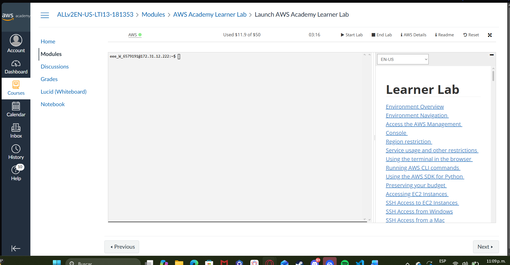

*Función creada (Java 17, LabRole)*

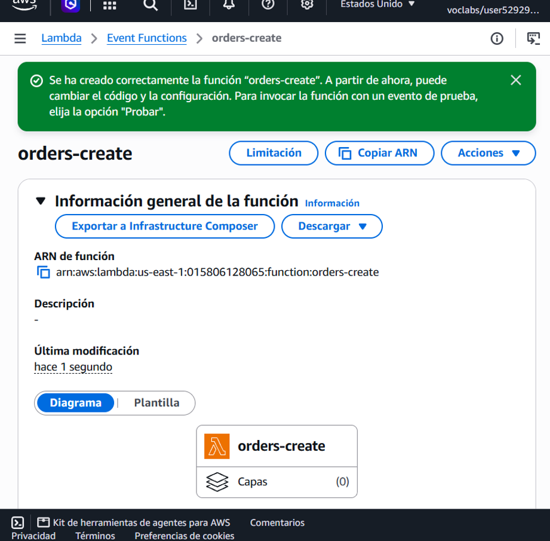

*Carga del JAR orders-api-1.0.0.jar*

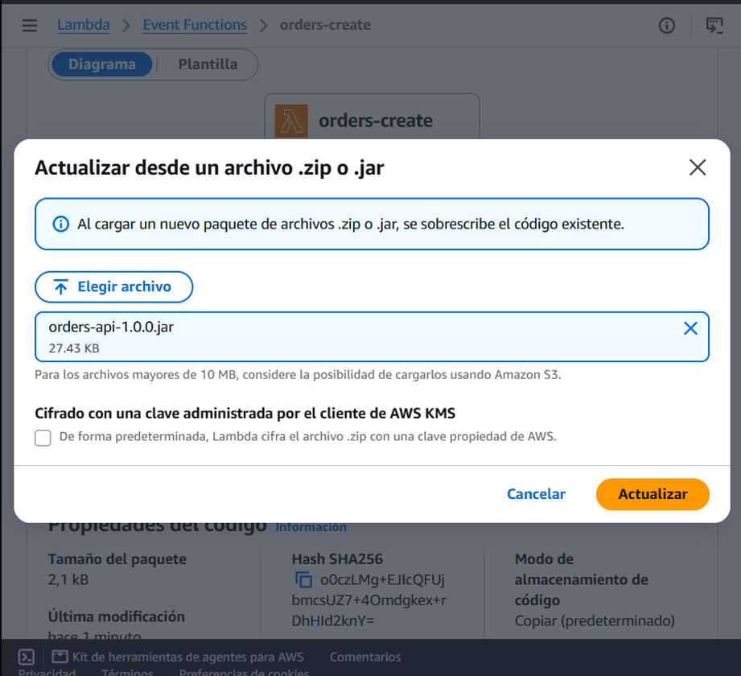

*Configuración del handler*

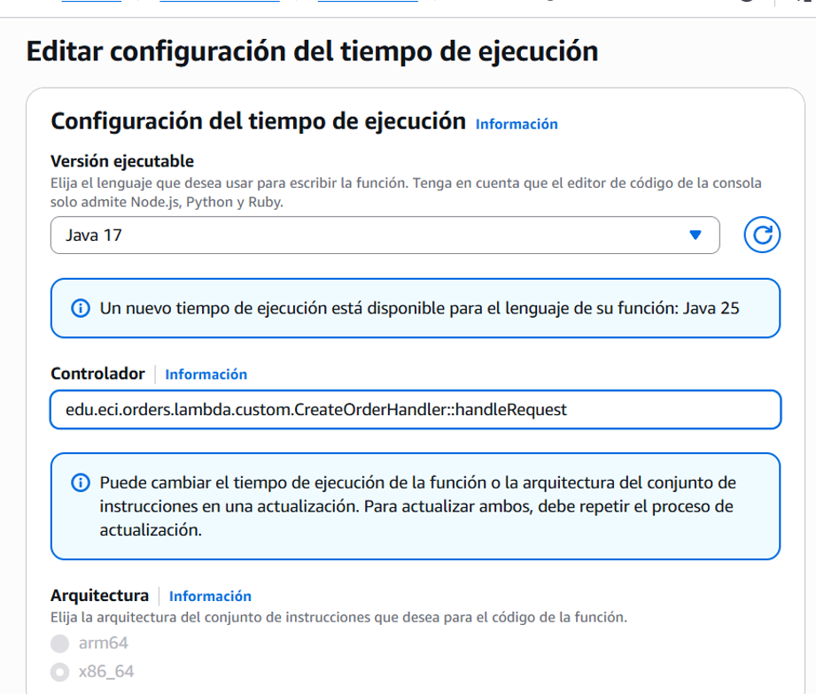

*Memoria 512 MB y timeout 15 s*

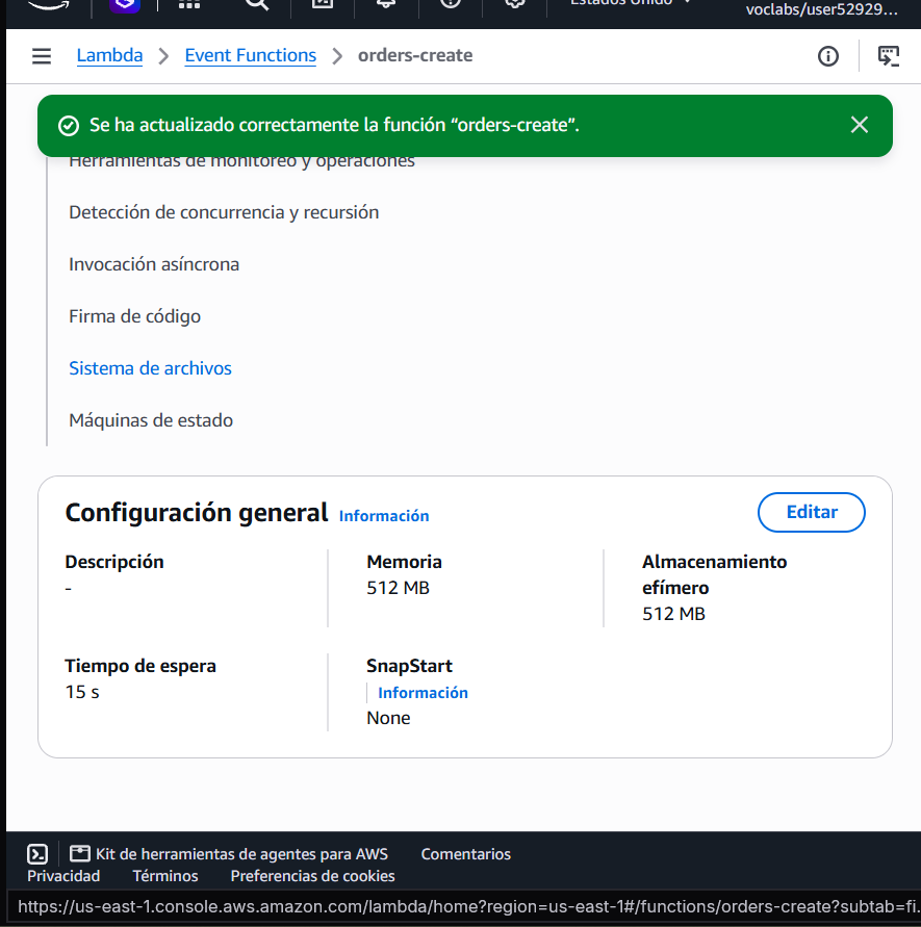

**Errores:** los handlers traducen las excepciones de dominio a una `OrderApiException` cuyo mensaje es el cuerpo de error en JSON (`{"error":"ORDER_NOT_FOUND","message":"..."}`). El handler **no** elige códigos HTTP; eso queda para API Gateway (Parte IV).

### Diagrama de la solución (Checkpoint 2)

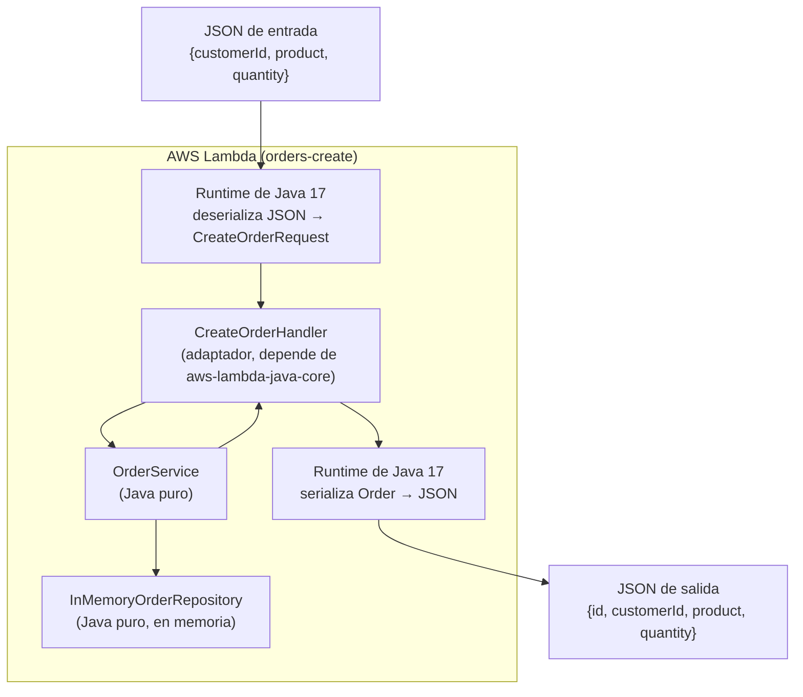

### Investigación: ¿cómo convierte Lambda JSON ↔ objetos Java?

1. En la configuración de la función, el **handler** (`paquete.Clase::metodo`) le indica al runtime qué clase instanciar y qué método invocar. El runtime crea la instancia con el constructor sin argumentos **una vez por entorno de ejecución** y la reutiliza en las invocaciones "warm" (por eso el `OrderService` estático conserva su estado entre invocaciones mientras el entorno siga vivo).
2. Por reflexión, el runtime lee el tipo genérico declarado en `RequestHandler<CreateOrderRequest, Order>` para saber a qué clase convertir la entrada.
3. Deserializa el JSON del evento con su serializador interno (basado en Jackson) siguiendo las convenciones de JavaBeans: crea el objeto con el constructor sin argumentos y asigna cada propiedad con su *setter*. Por eso `CreateOrderRequest` y `Order` son POJOs con constructor vacío y getters/setters.
4. Al terminar, serializa el valor de retorno a JSON usando los *getters*. Una `List<Order>` se convierte en un arreglo JSON.
5. Si el método lanza una excepción, el runtime responde con un JSON de error con la forma `{"errorMessage": ..., "errorType": ..., "stackTrace": [...]}`. `errorMessage` es el mensaje de la excepción.
6. Si se necesita control total del formato, se puede usar `RequestStreamHandler`, que recibe `InputStream`/`OutputStream` sin conversión automática.

### Verificación contra la Lambda desplegada (`orders-create`)

| # | Entrada | Resultado | Qué demuestra |
|---|---------|-----------|---------------|
| 1 | `{"customerId":"CUST-42","product":"MacBook Air","quantity":1}` | `{"id":"ORD-004","customerId":"CUST-42","product":"MacBook Air","quantity":1}` | El JSON se convierte en `CreateOrderRequest` y el `Order` retornado vuelve a JSON. Es `ORD-004` porque los datos de ejemplo ocupan `ORD-001`…`ORD-003`. Duración 61.83 ms, facturada 442 ms (arranque en frío: carga de la JVM y de las clases). |
| 2 | `{"customerId":"CUST-100","product":"Monitor","quantity":3}` | `{"id":"ORD-005",...}` | El entorno se reutilizó (invocación *warm*): el contador en memoria continuó en 5. |
| 3 | `{"customerId":"CUST-42","product":"Mouse","quantity":0}` | Error: `errorMessage` = `{"error":"INVALID_REQUEST","message":"quantity must be greater than 0"}`, `errorType` = `edu.eci.orders.lambda.custom.OrderApiException`, más `stackTrace` | Una excepción del handler se convierte en el JSON de error del runtime; `errorMessage` es el mensaje de la excepción. |
| 4 | `{"customerId":"CUST-42","product":"Mouse","quantity":1,"color":"red"}` | `{"id":"ORD-006",...}` | Las propiedades desconocidas se **ignoran**; no hacen fallar la deserialización. Duración 1.86 ms (warm). |
| 5 | `{"customerId":"CUST-42","product":"Mouse","quantity":"abc"}` | Error: `errorMessage` = `"An error occurred during JSON parsing"`, `errorType` = `java.lang.RuntimeException`, `stackTrace` = `[]` | La conversión ocurre **antes** de llamar al handler: con un tipo incompatible, el runtime falla al parsear y el código Java nunca se ejecuta (la traza está vacía y no aparece `CreateOrderHandler`). |

**Evidencia: invocaciones manuales de `orders-create`**

*1. CUST-42 → ORD-004*

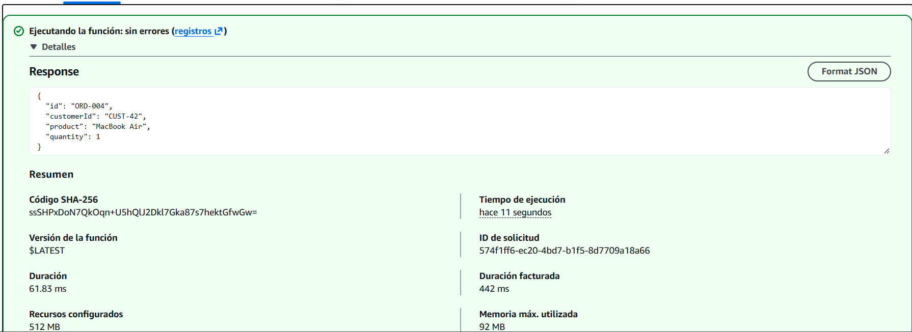

*2. CUST-100 → ORD-005 (entorno reutilizado)*

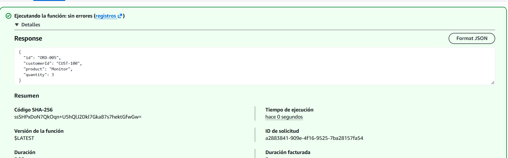

*3. quantity = 0 → INVALID_REQUEST*

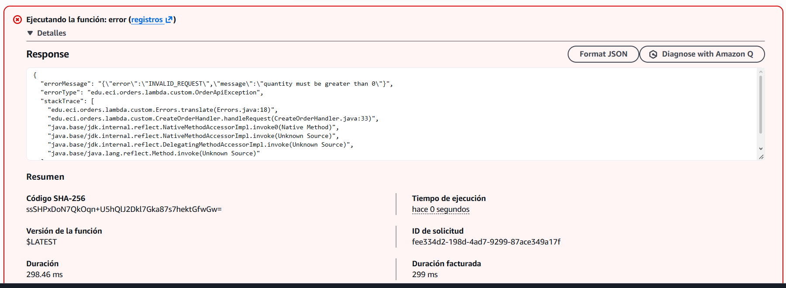

*4. Propiedad desconocida "color" → ignorada*

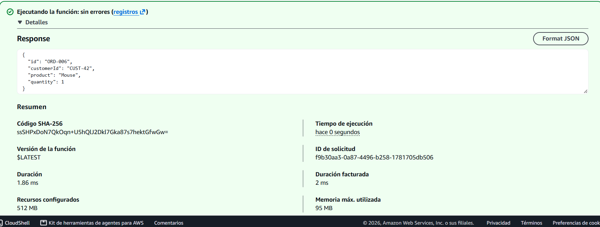

*5. quantity = "abc" → error de parsing del runtime*

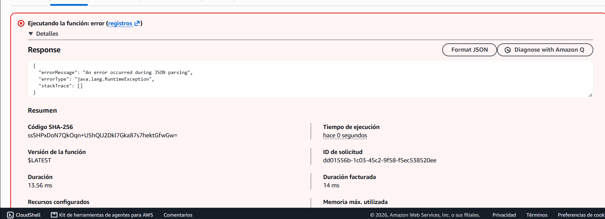

### Conclusión

El runtime de Java de Lambda actúa como un adaptador de serialización entre el mundo JSON y el método Java. Usa la firma genérica del handler para saber a qué tipo convertir la entrada, deserializa con convenciones de JavaBeans (ignorando propiedades desconocidas), invoca el método y serializa el valor de retorno con sus getters. Hay dos tipos de error distintos:

- **Errores del runtime** (JSON con forma incorrecta): se producen antes de llegar a nuestro código y devuelven un mensaje genérico (`An error occurred during JSON parsing`).
- **Errores de nuestro código** (excepciones): el runtime los serializa como `errorMessage`/`errorType`/`stackTrace`.

Como el `stackTrace` expone detalles internos, la respuesta cruda de Lambda no debe llegar tal cual a un cliente HTTP. Ese filtrado es una de las responsabilidades que se asignan a API Gateway en la Parte IV.

La reutilización del entorno (ORD-004 → 005 → 006) confirma que el estado en memoria sobrevive entre invocaciones *warm*. Sin embargo, no es persistente: se pierde cuando Lambda recicla el entorno y no se comparte entre funciones.

### Observación: el handler se resuelve en tiempo de ejecución

Al crear `orders-get`, la primera invocación falló con `ClassNotFoundException: edu.eci.orders.lambda.custom.GetOrderHandler`. El SHA-256 del código (`o0czLMg+...`) era el del código de ejemplo que Lambda crea por defecto: el JAR no se había subido. Después de subirlo, el SHA-256 pasó a `ssSHPxDoN7Qk...` (el mismo de `orders-create`) y la función respondió correctamente.

Esto confirma que Lambda **no valida el handler al guardar la configuración**: carga la clase por reflexión en la primera invocación (arranque en frío). Un error en el nombre del handler o en el empaquetado solo se detecta al invocar la función.

**Evidencia: creación de `orders-get` y `ClassNotFoundException`**

*Función orders-get creada*

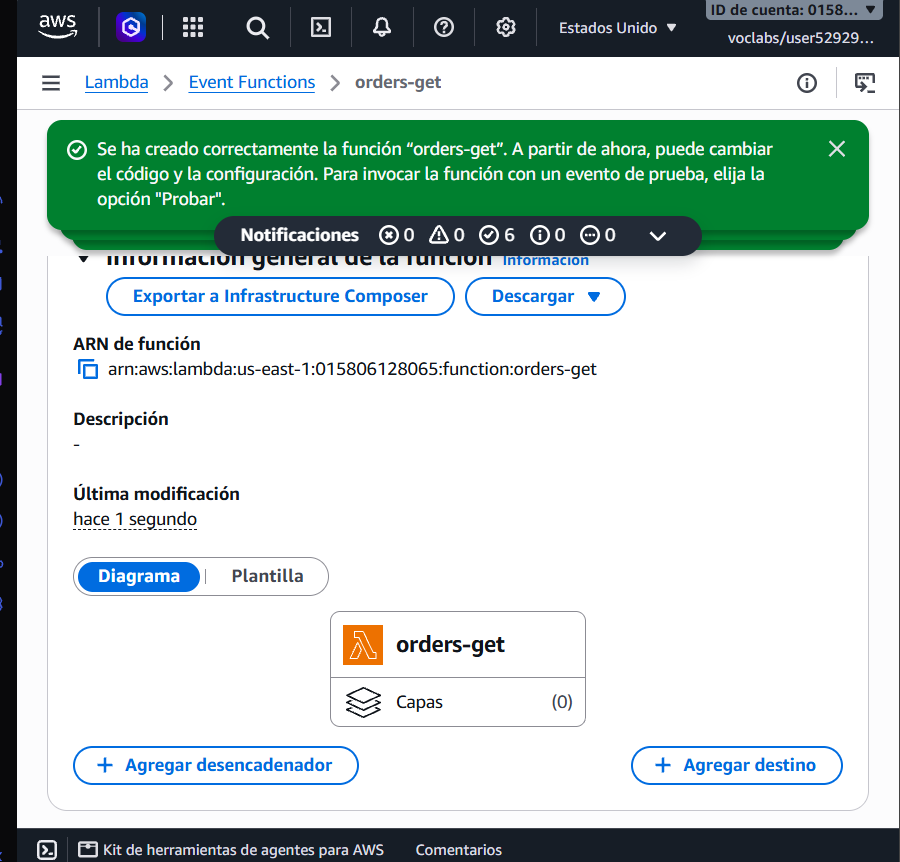

*Handler GetOrderHandler configurado*

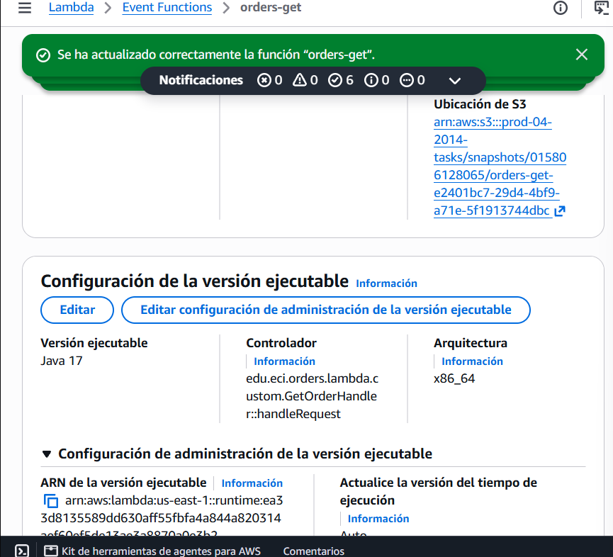

*ClassNotFoundException (JAR no cargado, SHA-256 del código por defecto)*

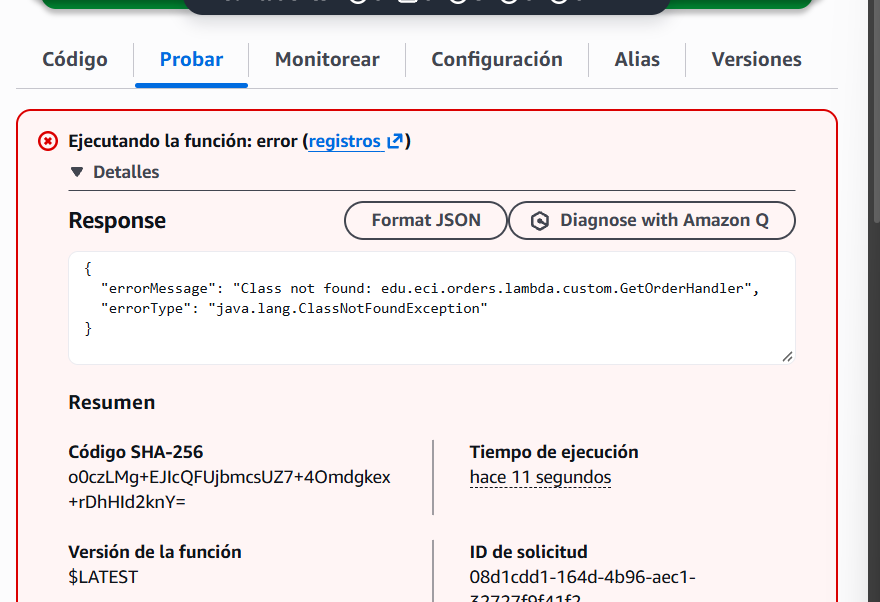

| Lambda | Entrada | Resultado |
|---|---|---|
| `orders-get` | `{"id":"ORD-001"}` | `{"id":"ORD-001","customerId":"CUST-42","product":"MacBook Air","quantity":1}` |
| `orders-get` | `{"id":"ORD-999"}` | Error: `errorMessage` = `{"error":"ORDER_NOT_FOUND","message":"Order ORD-999 does not exist"}` |
| `orders-find` | `{"customerId":"CUST-42"}` | `[{"id":"ORD-001",...,"product":"MacBook Air"},{"id":"ORD-002",...,"product":"Magic Mouse"}]` |
| `orders-find` | `{"customerId":"CUST-100"}` | `[]` |
| `orders-find` | `{"customerId":""}` | Error: `errorMessage` = `{"error":"INVALID_REQUEST","message":"customerId is required"}` |

**Evidencia: invocaciones de `orders-get` y `orders-find`**

*orders-get: ORD-001*

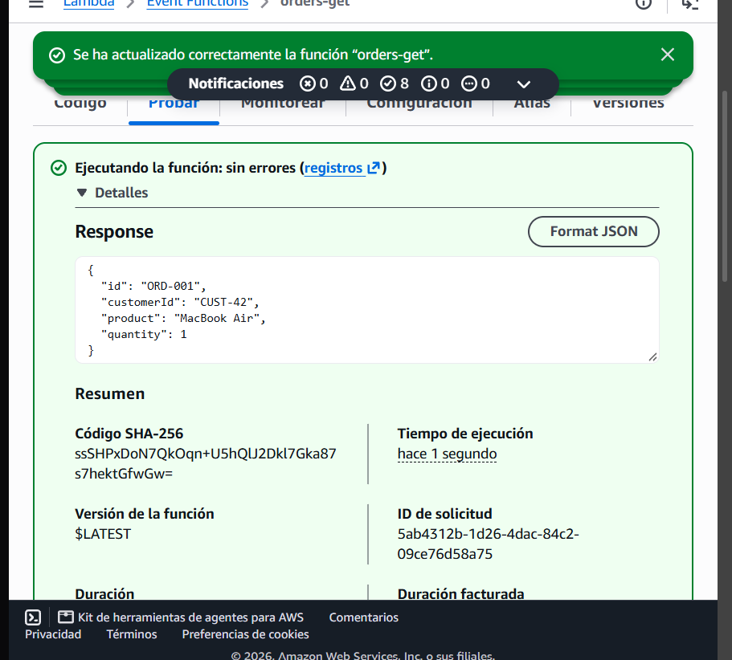

*orders-get: ORD-999 → ORDER_NOT_FOUND*

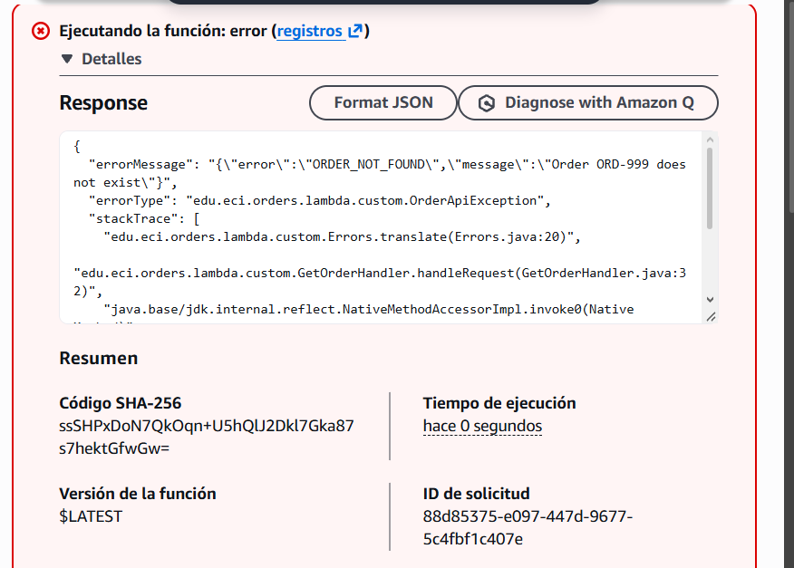

*orders-find: CUST-42 → 2 órdenes*

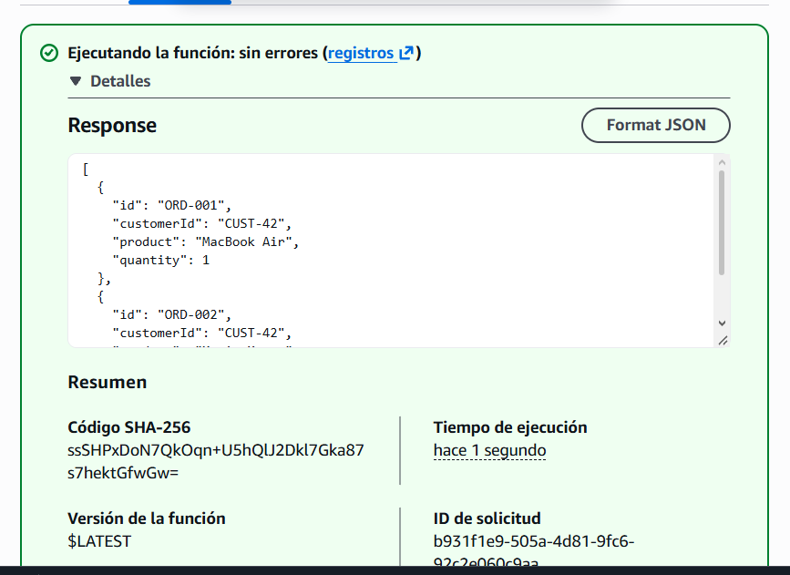

*orders-find: CUST-100 → []*

![orders-find: CUST-100 → []](docs/evidence/part2/16-orders-find-cust100.png)

*orders-find: customerId vacío → INVALID_REQUEST*

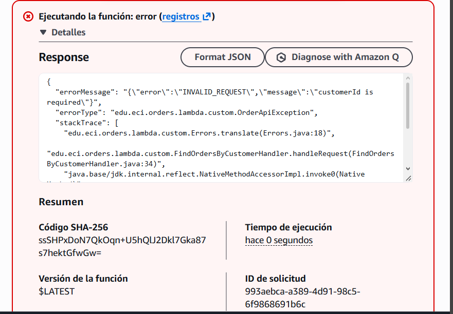

`orders-find` devuelve `[]` para `CUST-100` aunque `orders-create` ya había creado `ORD-005` para ese cliente. Cada función Lambda tiene su propio entorno de ejecución y, por lo tanto, su propia copia del repositorio en memoria. Con una Lambda por operación, el estado no se comparte entre operaciones.

---

## 4. Partes III y IV — API Gateway con integración no-proxy (Arquitectura A)

API REST `orders-api-mapping` (Regional) en API Gateway, con integración Lambda **sin proxy**: API Gateway transforma la petición HTTP en el JSON exacto que espera cada handler, y transforma la respuesta de Lambda en una respuesta HTTP.

Las plantillas de mapeo usadas están en [apigateway/architecture-a/](apigateway/architecture-a/).

**Recursos y métodos de la API `orders-api-mapping`:**

```
/
└── /orders
    ├── GET     → orders-find    (?customerId=...)
    ├── POST    → orders-create
    └── /{id}
        └── GET → orders-get
```

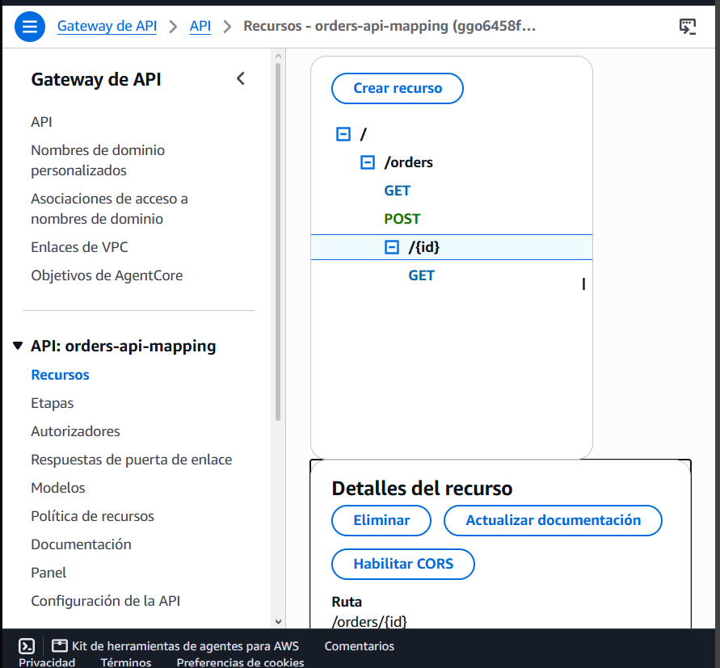

### `GET /orders/{id}` → `orders-get`

**Solicitud de integración**, plantilla `application/json` ([get-order.request.vtl](apigateway/architecture-a/get-order.request.vtl)):

```
{
  "id": "$util.escapeJavaScript($input.params('id'))"
}
```

`$input.params('id')` toma el valor del parámetro de ruta `{id}`, y API Gateway construye `{"id":"ORD-001"}`. El handler nunca ve la petición HTTP, solo el identificador.

**Evidencia: recurso `/orders/{id}` con método GET (proxy desactivado)**

*Recursos /orders y /{id} con método GET*

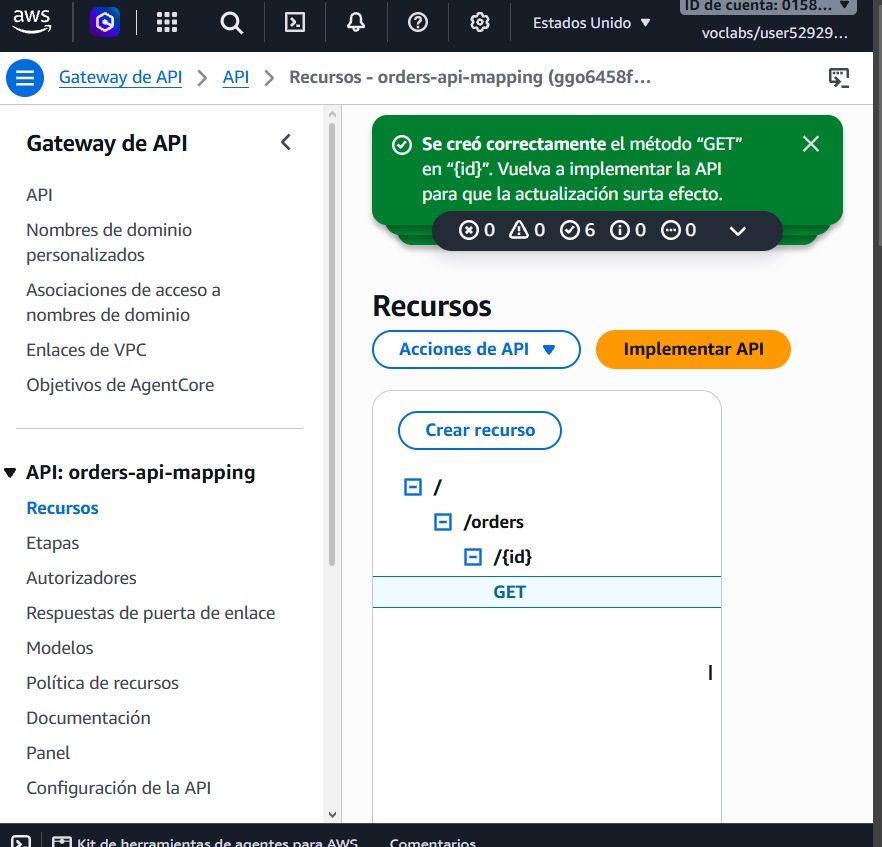

*Pantalla Solicitud de método: aquí no están las plantillas de mapeo (van en Solicitud de integración)*

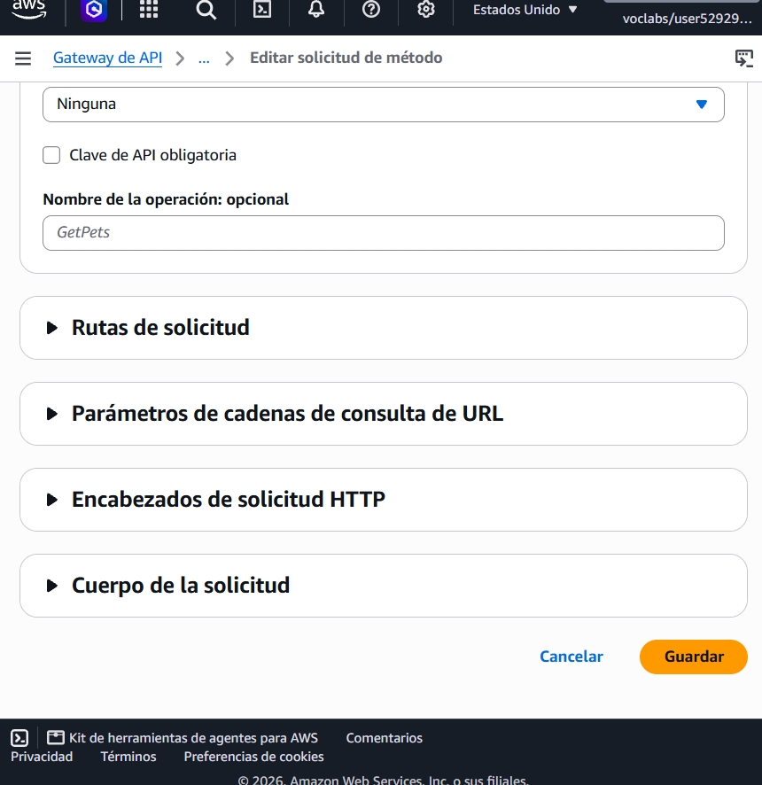

**Hallazgo: sin mapeo de errores, todo es 200.** Con solo la plantilla de solicitud configurada:

| Petición | Estado | Cuerpo |
|---|---|---|
| `GET /orders/ORD-001` | 200 | `{"id":"ORD-001","customerId":"CUST-42","product":"MacBook Air","quantity":1}` |
| `GET /orders/ORD-999` | **200** | `{"errorMessage":"{\"error\":\"ORDER_NOT_FOUND\",...}","errorType":"...OrderApiException","stackTrace":[...]}` |

**Evidencia: prueba de `GET /orders/{id}` antes de mapear errores**

*ORD-001 → 200*

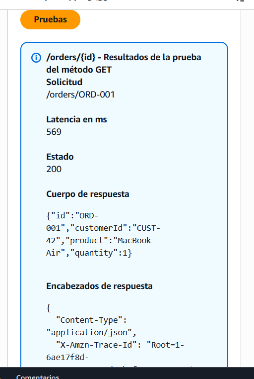

*ORD-999 → 200 con la respuesta cruda de Lambda (stackTrace incluido)*

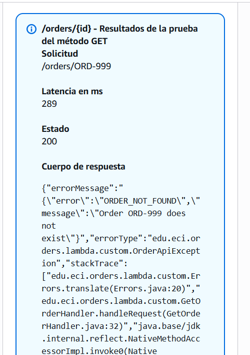

En la integración no-proxy, API Gateway responde con la *respuesta de integración por defecto* (200) a menos que una expresión regular sobre `errorMessage` indique otra cosa. Además, se filtra al cliente el `stackTrace` interno. Por eso el mapeo de errores a códigos HTTP es una responsabilidad explícita que hay que configurar en API Gateway, ruta por ruta.

**Mapeo de errores para `GET /orders/{id}`:**

1. *Respuesta de método*: se declara el código `404` (modelo `Empty`, `application/json`).
2. *Respuesta de integración*: expresión regular `.*"error":"ORDER_NOT_FOUND".*` sobre el `errorMessage` de Lambda → estado `404`, con la plantilla [error.response.vtl](apigateway/architecture-a/error.response.vtl), que devuelve solo el `errorMessage` (nuestro JSON de error) y descarta `errorType` y `stackTrace`.

Con solo el paso de la regex, el estado ya era 404, pero el cuerpo seguía siendo la respuesta cruda de Lambda. El **código de estado** y el **cuerpo** de la respuesta se configuran por separado en API Gateway.

| Petición | Estado | Cuerpo |
|---|---|---|
| `GET /orders/ORD-999` | 404 | `{"error":"ORDER_NOT_FOUND","message":"Order ORD-999 does not exist"}` |

**Evidencia: mapeo del 404**

*Respuesta de integración: regex ORDER_NOT_FOUND → 404*

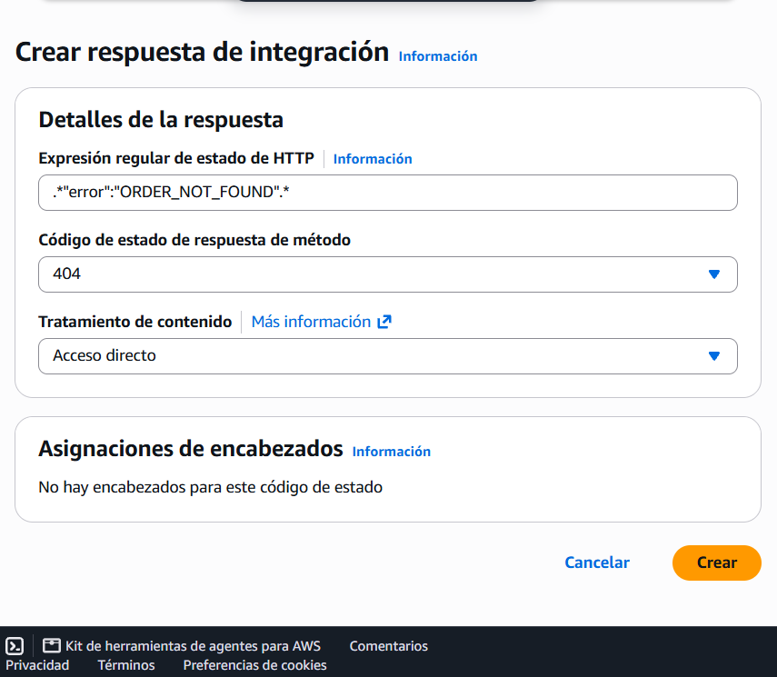

*Regex configurada, sin plantilla: 404 pero con cuerpo crudo*

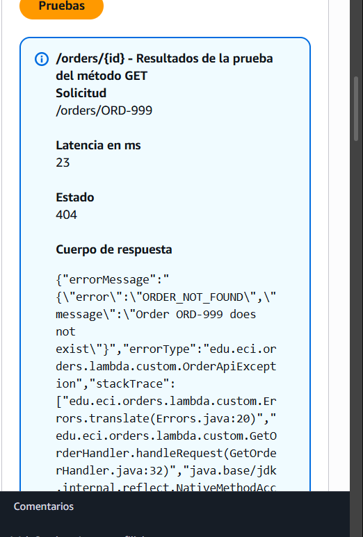

*Regex + plantilla: 404 con el error en el formato del API*

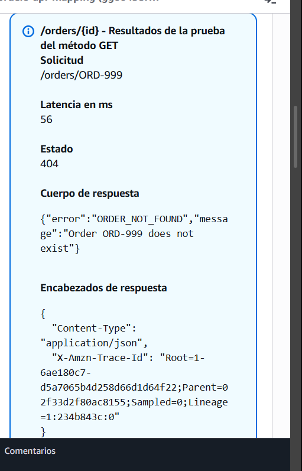

**Despliegue:** etapa `dev`, URL de invocación `https://ggo6458fw1.execute-api.us-east-1.amazonaws.com/dev`.

```
$ curl -i https://ggo6458fw1.execute-api.us-east-1.amazonaws.com/dev/orders/ORD-001
HTTP/1.1 200 OK
Content-Type: application/json

{"id":"ORD-001","customerId":"CUST-42","product":"MacBook Air","quantity":1}

$ curl -i https://ggo6458fw1.execute-api.us-east-1.amazonaws.com/dev/orders/ORD-999
HTTP/1.1 404 Not Found
Content-Type: application/json

{"error":"ORDER_NOT_FOUND","message":"Order ORD-999 does not exist"}
```

**Evidencia: etapa `dev`**

*Etapa dev y URL de invocación*

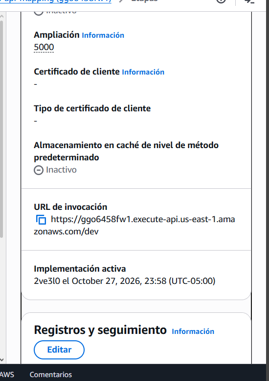

`GET /orders/ORD-004` también devuelve 404, aunque `orders-create` creó esa orden en la Parte II: la orden vive en la memoria de otra función Lambda.

### `GET /orders?customerId={customerId}` → `orders-find`

- *Solicitud de método*: se declara el parámetro de consulta `customerId`, sin marcarlo como obligatorio. La validación queda en `OrderService` para que el error tenga el mismo formato que el resto del API.
- *Solicitud de integración*, plantilla `application/json` ([find-orders.request.vtl](apigateway/architecture-a/find-orders.request.vtl)):
  ```
  {
    "customerId": "$util.escapeJavaScript($input.params('customerId'))"
  }
  ```
  `$input.params('customerId')` busca el nombre en la ruta, la query string y los headers. Si no existe, devuelve una cadena vacía, y `OrderService` la rechaza.
- *Respuesta de método*: `400`.
- *Respuesta de integración*: regex `.*"error":"INVALID_REQUEST".*` → `400`, con la plantilla [error.response.vtl](apigateway/architecture-a/error.response.vtl).

En la consola, una *Respuesta de integración* solo se puede crear para códigos ya declarados en la *Respuesta de método* ("No hay códigos de estado de respuesta de método disponibles"). Primero se declara qué puede responder el API y después se define cuándo.

Resultados en la pestaña *Prueba* de la consola de API Gateway:

| Petición | Estado | Cuerpo |
|---|---|---|
| `GET /orders?customerId=CUST-42` | 200 | `[{"id":"ORD-001",...,"product":"MacBook Air",...},{"id":"ORD-002",...,"product":"Magic Mouse",...}]` |
| `GET /orders?customerId=CUST-100` | 200 | `[]` |
| `GET /orders` (sin `customerId`) | 400 | `{"error":"INVALID_REQUEST","message":"customerId is required"}` |

**Evidencia: `GET /orders?customerId=`**

*Sin códigos declarados en Respuesta de método no se puede crear la Respuesta de integración*

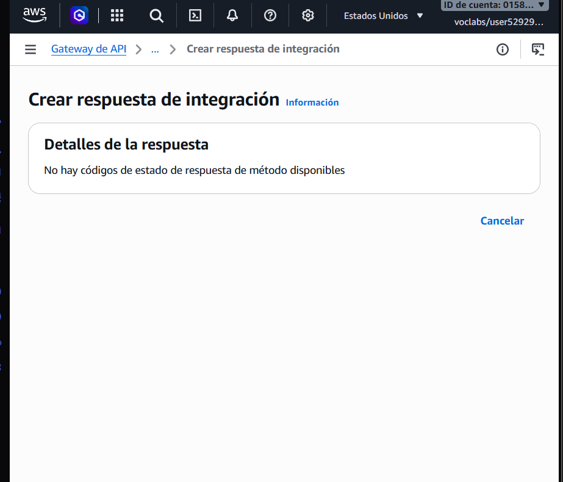

*customerId=CUST-42 → 200*

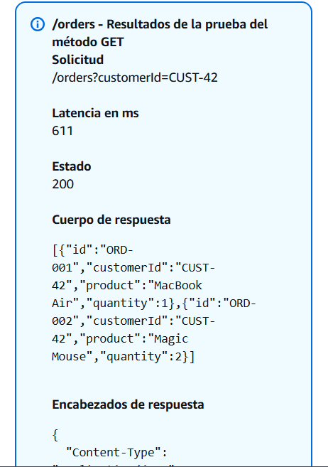

*customerId=CUST-100 → 200 []*

![customerId=CUST-100 → 200 []](docs/evidence/part4/09-find-cust100-200-empty.png)

*Sin customerId → 400 INVALID_REQUEST*

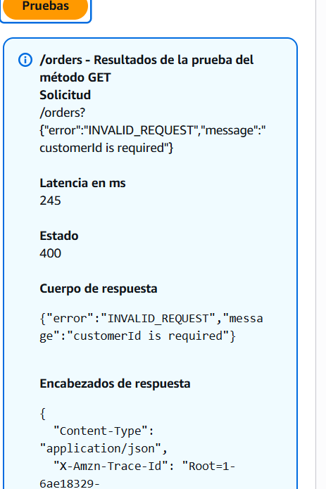

*Sin customerId → 400 (prueba repetida)*

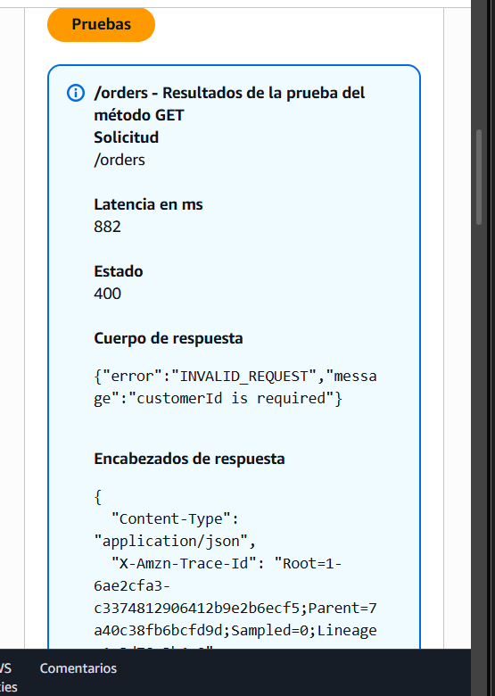

**Cambios sin implementar:** antes de volver a implementar la etapa, `GET /orders?customerId=CUST-42` en la URL pública respondía `403 {"message":"Missing Authentication Token"}`. API Gateway da esa respuesta para cualquier ruta o método que no existe en la etapa desplegada. Los cambios de configuración solo se publican al implementar el API en una etapa.

### `POST /orders` → `orders-create`

- *Solicitud de integración*, plantilla `application/json` ([create-order.request.vtl](apigateway/architecture-a/create-order.request.vtl)): `$input.json('$')`, que pasa el cuerpo de la petición sin cambios, porque ya tiene la forma de `CreateOrderRequest`.
- *Respuesta de método*: `201` y `400`.
- *Respuesta de integración*:

| Regex sobre `errorMessage` | Estado | Plantilla |
|---|---|---|
| *(vacía, respuesta predeterminada)* | **201** | ninguna: se devuelve la orden creada |
| `(.*"error":"INVALID_REQUEST".*)\|(An error occurred during JSON parsing.*)` | **400** | [error.response.vtl](apigateway/architecture-a/error.response.vtl) |

La segunda alternativa de la regex cubre el error que genera el **runtime de Lambda** (no nuestro código) cuando el JSON no se puede convertir a `CreateOrderRequest`. En ese caso `errorMessage` no es nuestro JSON de error, y la rama `#else` de la plantilla construye uno con el formato del API.

**Hallazgos de configuración:**
- El código de estado de una respuesta de integración existente **no se puede editar**: las respuestas de integración se identifican por su código. Para que el éxito respondiera 201 hubo que eliminar la respuesta predeterminada 200 y crear otra con regex vacía y código 201.
- Solo puede existir una respuesta con regex vacía ("Integration response with selection pattern default already exists").

**Evidencia: configuración de la respuesta 201**

*La respuesta predeterminada existente no permite cambiar su código (200)*

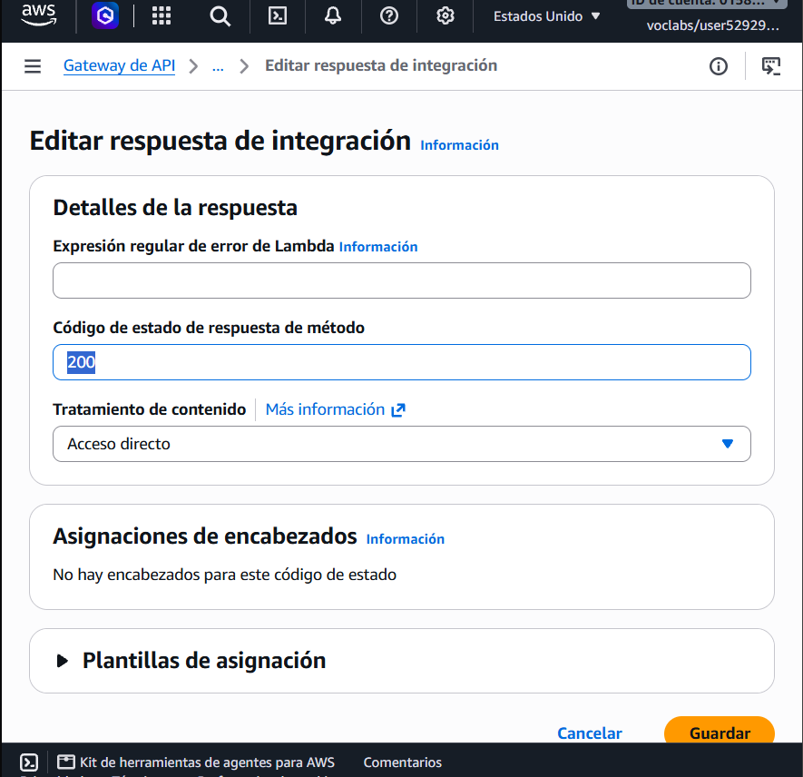

*Solo puede haber una respuesta con regex vacía*

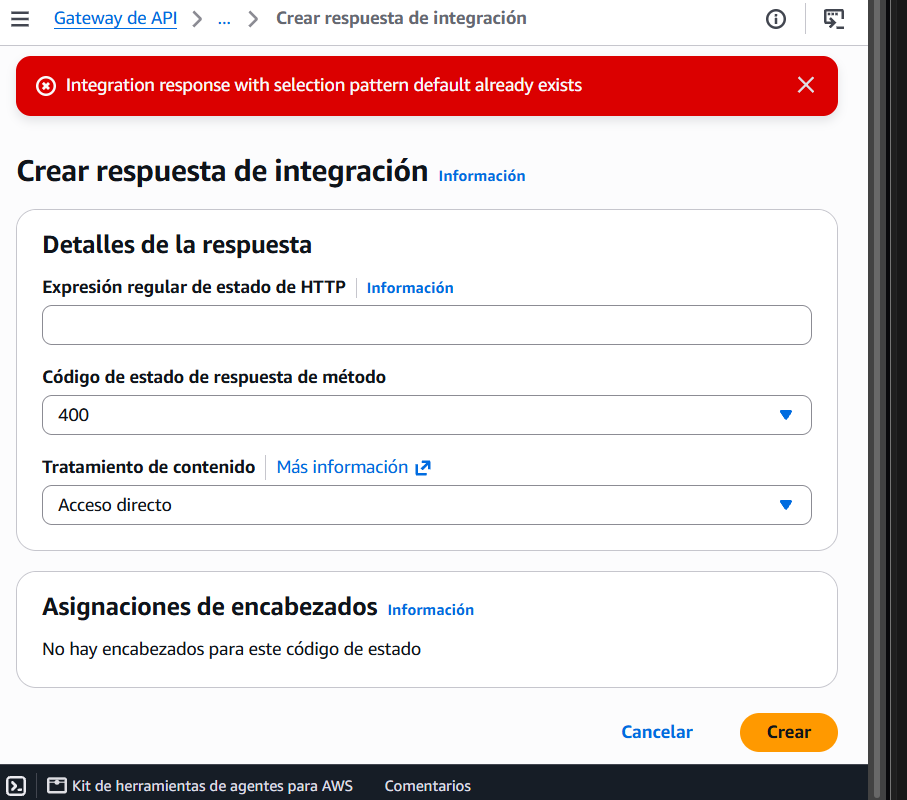

*Respuesta predeterminada recreada con código 201*

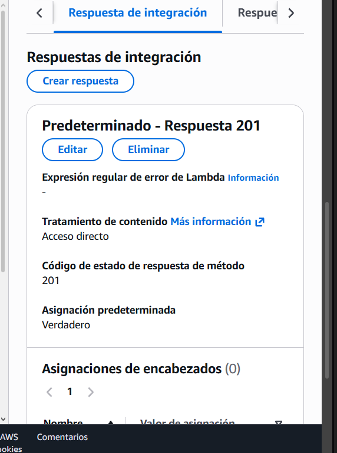

| Cuerpo enviado | Estado | Respuesta |
|---|---|---|
| `{"customerId":"CUST-42","product":"MacBook Air","quantity":1}` | **201** | `{"id":"ORD-004","customerId":"CUST-42","product":"MacBook Air","quantity":1}` |
| `{"customerId":"CUST-42","product":"Mouse","quantity":0}` | **400** | `{"error":"INVALID_REQUEST","message":"quantity must be greater than 0"}` |
| `{"customerId":"CUST-42","product":"Mouse","quantity":"abc"}` | **400** | `{"error":"INVALID_REQUEST","message":"Request body is not valid JSON"}` |
| `{"customerId":"CUST-42","quantity":2}` | **400** | `{"error":"INVALID_REQUEST","message":"product is required"}` |

**Evidencia: pruebas de `POST /orders`**

*Creación válida → 201*

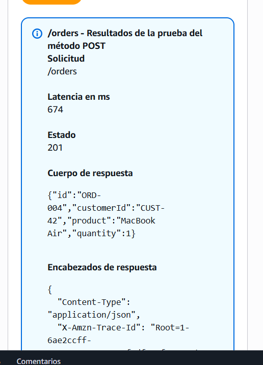

*quantity = 0 → 400*

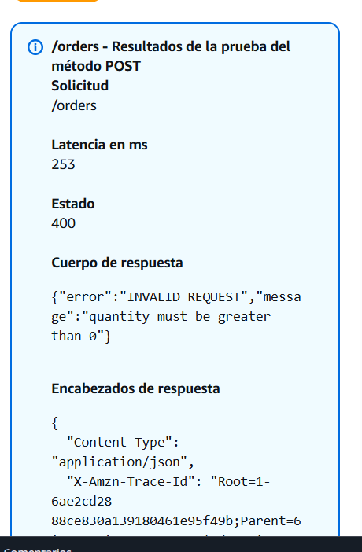

*quantity = "abc" → 400 (error del runtime traducido por la plantilla)*

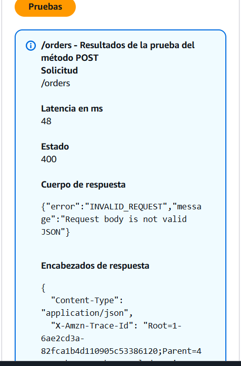

*Sin product → 400*

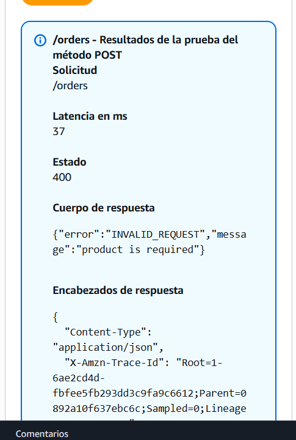

**La memoria se perdió.** La creación válida devolvió de nuevo `ORD-004`, aunque en la Parte II la misma función `orders-create` había llegado a `ORD-006`. Entre ambas pruebas Lambda recicló el entorno de ejecución (la latencia de 674 ms corresponde a un arranque en frío) y el repositorio en memoria volvió a los datos de ejemplo. Los datos en memoria de una Lambda no son persistentes; un sistema real necesita un almacén externo (por ejemplo DynamoDB).

**Limitación: header `Location`.** En la integración no-proxy, un header de respuesta solo puede tomar un valor estático o un valor copiado del cuerpo (`integration.response.body.id` → `ORD-004`). No se puede construir la URL `/orders/ORD-004` sin modificar la respuesta de Lambda, así que la Arquitectura A responde 201 **sin** `Location`.

Salida completa de las pruebas HTTP de la Arquitectura A: [docs/examples/architecture-a.txt](docs/examples/architecture-a.txt).

---

## 5. Parte V — Integración Lambda proxy y adaptador HTTP (Arquitectura B)

### Diseño

Una sola función Lambda, `orders-api`, atiende todo el API. API Gateway ya no transforma nada: reenvía la petición HTTP completa como un evento y devuelve tal cual la respuesta que construye Lambda.

```
src/main/java/edu/eci/orders/
├── domain/, application/, infrastructure/   ← sin cambios (Java puro)
└── lambda/
    ├── custom/   ← Arquitectura A: un handler por operación, entrada ya transformada
    └── proxy/    ← Arquitectura B
        ├── OrdersApiHandler.java   ← adaptador HTTP: única clase que conoce HTTP
        └── ErrorBody.java          ← cuerpo JSON de error
```

`OrdersApiHandler` implementa `RequestHandler<APIGatewayProxyRequestEvent, APIGatewayProxyResponseEvent>` (de `aws-lambda-java-events`) y es responsable de:

| Responsabilidad | Cómo |
|---|---|
| Enrutamiento | `httpMethod` + `resource` del evento (`/orders`, `/orders/{id}`) |
| Parámetros | `pathParameters.id`, `queryStringParameters.customerId` |
| Cuerpo | `body` (string) → `CreateOrderRequest` con Jackson; JSON inválido → 400 |
| Códigos HTTP | `ValidationException` → 400, `OrderNotFoundException` → 404, método no soportado → 405, cualquier otra excepción → 500 |
| Headers | `Content-Type: application/json`; `Location` en el 201, construido con `requestContext.path` para incluir la etapa (`/dev/orders/ORD-004`) |
| Errores internos | Se registran en CloudWatch; el cliente recibe solo `{"error":"INTERNAL_ERROR","message":"Unexpected error"}` |

`OrderService` no cambió: la lógica de negocio sigue sin saber nada de HTTP ni de AWS.

**Pruebas locales:** [OrdersApiHandlerTest](src/test/java/edu/eci/orders/lambda/proxy/OrdersApiHandlerTest.java) construye eventos de API Gateway en memoria y verifica estado, headers y cuerpo de 12 casos, incluido el **500**: se simula un repositorio que lanza una excepción inesperada. En la Arquitectura A esas mismas reglas (qué error es 404, qué es 400) viven en la consola de API Gateway y solo se pueden probar desplegando.

### Configuración

- **Lambda** `orders-api`: Java 17, x86_64, `LabRole`, 512 MB, 15 s, handler `edu.eci.orders.lambda.proxy.OrdersApiHandler::handleRequest`.
- **API REST** `orders-api-proxy` (Regional), etapa `dev`, URL `https://ye9icxasx9.execute-api.us-east-1.amazonaws.com/dev`:

```
/
└── /orders          ANY → orders-api (proxy)
    └── /{id}        ANY → orders-api (proxy)
```

Son solo 2 métodos, sin plantillas de mapeo, sin expresiones regulares y sin respuestas de método ni de integración. Se usa `ANY` para que todos los métodos HTTP lleguen al adaptador y sea Java quien responda 405 a los no soportados.

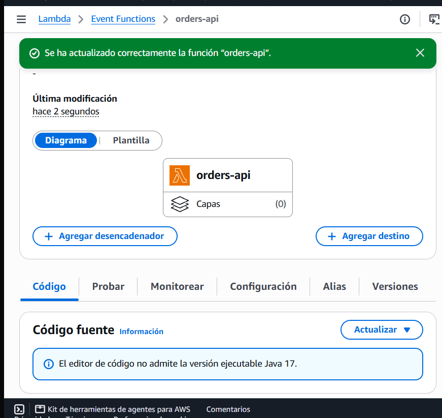

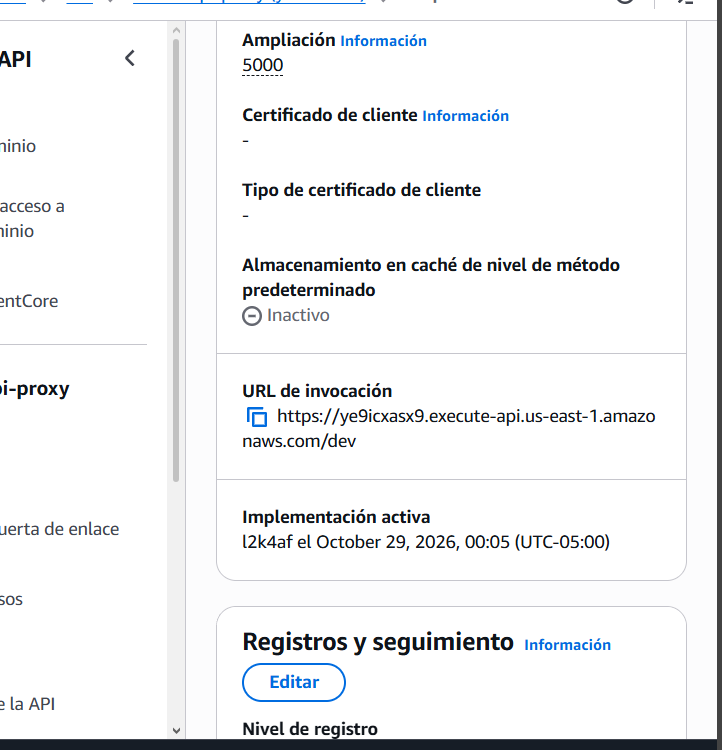

### Resultados (URL pública)

| Petición | Estado | Cuerpo / headers |
|---|---|---|
| `GET /orders/ORD-001` | 200 | `{"id":"ORD-001","customerId":"CUST-42","product":"MacBook Air","quantity":1}` |
| `GET /orders/ORD-999` | 404 | `{"error":"ORDER_NOT_FOUND","message":"Order ORD-999 does not exist"}` |
| `GET /orders?customerId=CUST-42` | 200 | `[{"id":"ORD-001",...},{"id":"ORD-002",...}]` |
| `GET /orders?customerId=CUST-100` | 200 | `[]` |
| `GET /orders` | 400 | `{"error":"INVALID_REQUEST","message":"customerId is required"}` |
| `POST /orders` válido | **201** | `Location: /dev/orders/ORD-004` + la orden creada |
| `POST /orders` con `quantity: 0` | 400 | `{"error":"INVALID_REQUEST","message":"quantity must be greater than 0"}` |
| `POST /orders` con `quantity: "abc"` | 400 | `{"error":"INVALID_REQUEST","message":"Request body is not valid JSON"}` |
| `POST /orders` con JSON truncado | 400 | `{"error":"INVALID_REQUEST","message":"Request body is not valid JSON"}` |
| `POST /orders` sin cuerpo | 400 | `{"error":"INVALID_REQUEST","message":"Request body is required"}` |
| `PATCH /orders/ORD-001` | 405 | `{"error":"METHOD_NOT_ALLOWED","message":"Method PATCH is not allowed on /orders/{id}"}` |

Salida completa: [docs/examples/architecture-b.txt](docs/examples/architecture-b.txt).

**Estado compartido entre operaciones.** Como todas las operaciones corren en la misma Lambda, una orden creada con `POST` es visible inmediatamente con `GET`. Seguir el header `Location` devuelto (`/dev/orders/ORD-006`) responde 200, y `GET /orders?customerId=CUST-77` lista las dos órdenes recién creadas. En la Arquitectura A (una Lambda por operación) esto no ocurría. Aun así, sigue siendo memoria de un único entorno de ejecución: con varias instancias concurrentes o después de un reciclaje, los datos no se comparten ni se conservan.

---

## 6. Reto final — `DELETE /orders/{id}`: predicción

> Escrita y versionada **antes** de implementar la operación. La implementación se compara con esta predicción en la sección siguiente.

Comportamiento esperado: `DELETE /orders/ORD-001` → `204 No Content` (sin cuerpo); `DELETE /orders/ORD-999` → `404 Not Found` con `{"error":"ORDER_NOT_FOUND",...}`.

La predicción se hace sobre la **Arquitectura B** (proxy), que es la que se extiende.

**1. ¿Qué clases Java deberían cambiar?**
- `OrderRepository`: nueva operación `deleteById(String id)` que indique si existía.
- `InMemoryOrderRepository`: su implementación (quitar la orden del mapa).
- `OrderService`: nuevo método `deleteOrder(String id)` que valida el id y lanza `OrderNotFoundException` si la orden no existe.
- `OrdersApiHandler`: nueva ruta `DELETE` en `/orders/{id}`.

`Order`, `CreateOrderRequest` y las excepciones de dominio no deberían cambiar. Los handlers de la Arquitectura A tampoco, porque no se extiende.

**2. ¿Se necesita una nueva Lambda?**
No. `orders-api` ya atiende todo el API; basta con subir el JAR nuevo. En la Arquitectura A sí haría falta, siguiendo su patrón de una Lambda (o al menos un handler) por operación.

**3. ¿Debe cambiar la configuración de API Gateway?**
No. `/orders/{id}` tiene el método `ANY` con integración proxy, así que un `DELETE` ya llega a Lambda. La evidencia es que hoy `DELETE /orders/ORD-001` responde **405 desde Java** (`METHOD_NOT_ALLOWED`), no 403 desde API Gateway. En la Arquitectura A habría que crear el método DELETE, su plantilla, las respuestas de método 204/404, la regex del 404 y volver a implementar la etapa.

**4. ¿Dónde debe vivir la lógica de borrado?**
En la aplicación: `OrderService.deleteOrder` decide las reglas (id obligatorio, la orden debe existir) y `OrderRepository` hace el borrado físico. El handler no debe tocar el repositorio directamente.

**5. ¿Dónde debe decidirse si se responde 204 o 404?**
En el adaptador HTTP (`OrdersApiHandler`). `OrderService` solo expresa el resultado en términos del dominio (termina normalmente o lanza `OrderNotFoundException`); el adaptador traduce: éxito → 204 sin cuerpo, `OrderNotFoundException` → 404. Esa traducción ya existe en el `catch` del handler, así que el 404 no debería requerir código nuevo.

**6. ¿Qué pruebas deben agregarse?**
- `OrderServiceTest`: borrar una orden existente y comprobar que después `getOrder` lanza `OrderNotFoundException`; borrar una inexistente lanza `OrderNotFoundException`; borrar con id vacío lanza `ValidationException`; borrar una orden no afecta las demás órdenes del cliente.
- `OrdersApiHandlerTest`: `DELETE` existente → 204 con cuerpo vacío; `DELETE` inexistente → 404 con el cuerpo de error; `GET` de la orden después de borrarla → 404; un segundo `DELETE` de la misma orden → 404.
